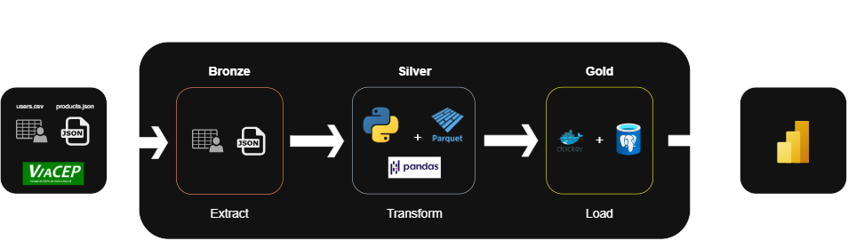

# Pipeline ETL com Python


Projeto de Engenharia de Dados desenvolvido com Python, com o objetivo de construir um pipeline ETL para extração, transformação, validação e armazenamento de dados fictícios de clientes e produtos.


O projeto utiliza uma arquitetura baseada em camadas (**Medallion Architecture**), contemplando as camadas **Silver** e **Gold**.


---


## Objetivo


Desenvolver um pipeline de dados capaz de extrair informações de diferentes fontes, realizar tratamentos e validações, enriquecer dados de clientes por meio de uma API externa e disponibilizar os dados estruturados para análises posteriores.


---


## Tecnologias Utilizadas


- Python

- Pandas

- PyArrow / Parquet

- API ViaCEP

- Git e GitHub

- PostgreSQL *(planejado)*

- Docker *(planejado)*


---


## Arquitetura do Projeto

O diagrama abaixo representa o fluxo de processamento dos dados, desde a extração das fontes de origem até o armazenamento na camada Silver


*Diagrama desenvolvido utilizando Draw.io.*


O pipeline está sendo desenvolvido seguindo as seguintes etapas:


### 1. Extração (Extract)


- Leitura dos dados fictícios de clientes armazenados em CSV.

- Leitura dos dados de produtos armazenados em JSON.


### 2. Transformação (Transform)


- Extração dos CEPs dos registros de clientes.

- Consulta à API ViaCEP para obtenção de informações de endereço.

- Normalização e tratamento dos dados.


### 3. Validação (Validate)


- Verificação da consistência dos dados.

- Validação dos registros após os processos de transformação.


### 4. Camada Silver


Os dados tratados, normalizados e validados são armazenados em arquivos Parquet:


- `users.parquet`

- `products.parquet`

- `cep_info.parquet`


### 5. Camada Gold (em desenvolvimento)


A próxima etapa consiste em utilizar PostgreSQL, executado em Docker, para estruturar e disponibilizar os dados enriquecidos para consultas e análises.


---


## Estrutura do Projeto


A estrutura de diretórios será documentada conforme a evolução do desenvolvimento.


```text

projeto-etl/

│

├── data/

│   ├── raw/

│   ├── silver/

│   └── gold/

│

├── src/

│   ├── extract/

│   ├── transform/

│   ├── validate/

│   └── load/

│

├── tests/

│

├── requirements.txt

├── README.md

└── .gitignore

```


---


## Como Executar


As instruções de instalação e execução serão adicionadas conforme a evolução do projeto.


---


## Dados Utilizados


O projeto utiliza conjuntos de dados inteiramente fictícios, gerados artificialmente para fins de estudo, desenvolvimento e demonstração.


Os arquivos de entrada e os dados processados podem ser encontrados no diretório `data/` do projeto.


---


## Status do Projeto


### Concluído ✅


- [x] Extração dos dados de clientes (CSV)

- [x] Extração dos dados de produtos (JSON)

- [x] Enriquecimento dos dados de clientes com a API ViaCEP

- [x] Normalização dos dados

- [x] Validação dos dados

- [x] Armazenamento da camada Silver em Parquet


### Em Desenvolvimento 🚧


- [ ] Implementação da camada Gold com PostgreSQL

- [ ] Containerização com Docker

- [ ] Documentação completa do pipeline


---


## Próximos Passos


1. Estruturar banco PostgreSQL para a camada Gold.

2. Criar scripts de carga dos dados tratados.

3. Containerizar a aplicação utilizando Docker.

4. Automatizar a execução do pipeline.

5. Implementar testes automatizados.

6. Criar dashboards e consultas analíticas.


---


## Autor

Nathan Luiz Almeida Vieira - Estagiário de Dados 👨‍💻

*Desenvolvido como projeto de estudo e prática em **Engenharia de Dados**.*
